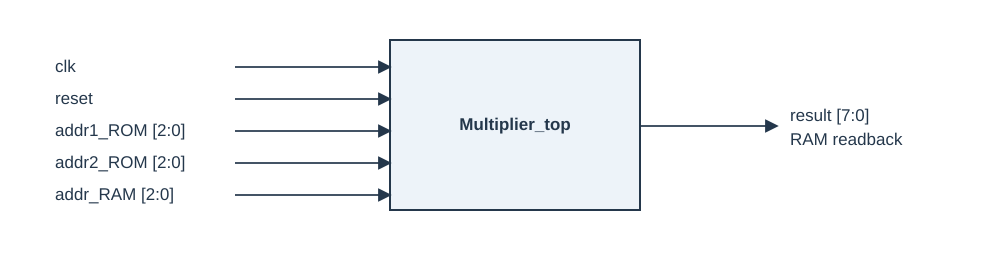
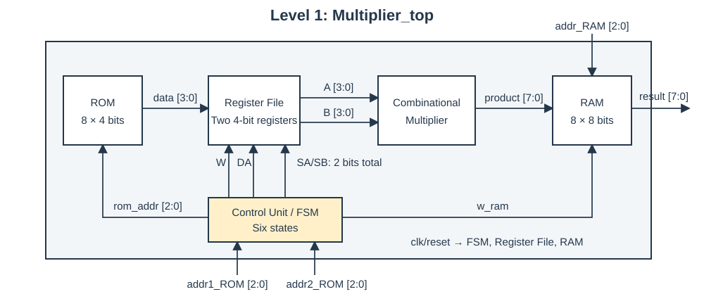
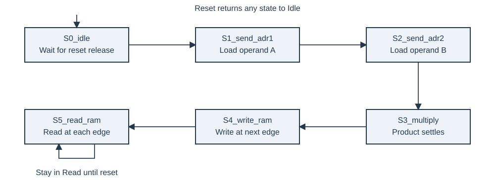

# ECE 128 Lab 10 prelab

## Level 0

The board wrapper splits SW8–SW0 into the three addresses. It sends the result
to LD7–LD0 and to the Lab 7 decimal display logic.

## Level 1 — based on slide 21

The datapath follows slide 21 of ECE128_L8_ROM_RAM.pdf: ROM → Register File →
Multiplier → RAM. The controller sits beneath the datapath. In this implementation,
clock and reset go to the controller, register file and RAM; the case ROM and
combinational multiplier need neither. SA/SB are fixed at 0/1. The RAM destination
goes directly to RAM. The result is the RAM output, not the multiplier output.

## Controller state diagram

Reset returns any state to Idle and clears RAM at the next rising clock edge.

| Edge after reset release | Action for ROM addresses 1 and 2, RAM address 0 |
| --- | --- |
| 1 | Leave Idle; select ROM address 1. |
| 2 | Capture 12 in register 0; select ROM address 2. |
| 3 | Capture 6 in register 1; the combinational product becomes 72. |
| 4 | Enter Write RAM; write enable goes high. |
| 5 | Store 72 at RAM address 0; enter Read RAM. |
| 6 | Read RAM address 0; result becomes 72. |

